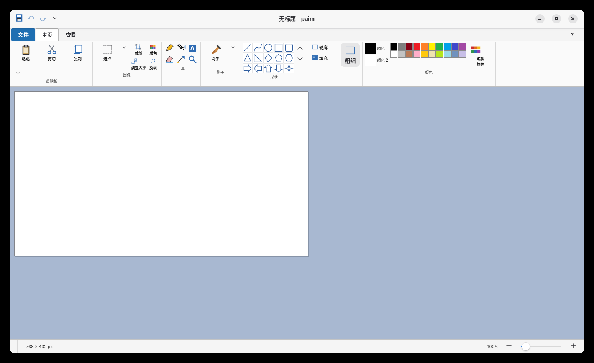
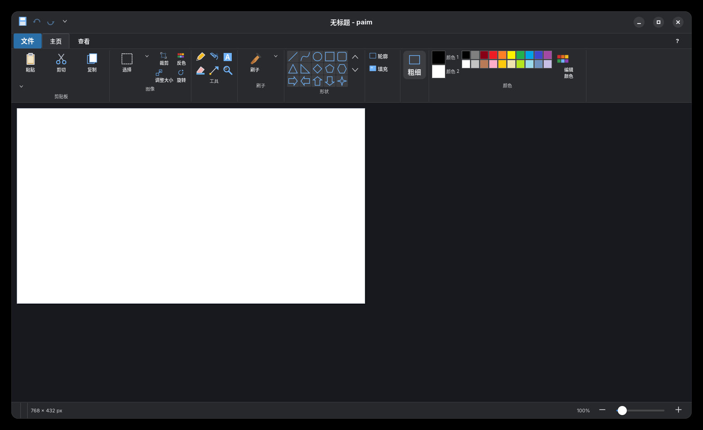

<!-- SPDX-License-Identifier: GPL-3.0-or-later OR CC-BY-NC-SA-4.0 -->

# paim (paintImproved)

**paim (paintImproved)** 是一个用 **Python + GTK4 + Cairo** 实现的 Linux 轻量绘图应用。它保留了经典画图软件的顺手交互，同时按 Linux 桌面习惯做了改进（例如 F11 为整个应用全屏、自动跟随系统深浅色主题）。

浅色模式：



深色模式（跟随系统主题）：



## 运行

Python 依赖（PyGObject、pycairo、Pillow）安装在项目目录下的 `.venv` 虚拟环境中，不会写入系统 Python。系统只需要 GTK4 运行库，以及编译 PyGObject 所需的工具和头文件。Arch Linux 上安装：

```bash
sudo pacman -S --needed gtk4 base-devel gobject-introspection
```

克隆并安装：

```bash
git clone https://github.com/myLiLingyun/paim.git
cd paim
./install.sh
```

`install.sh` 会：

- 在项目目录创建 `.venv`（已存在则复用），并安装 `requirements.txt` 中的依赖；PyGObject 需要从源码编译，首次安装可能需要几分钟；
- 把启动器链接到 `~/.local/bin/paim`，并安装图标和桌面入口；安装出来的桌面入口会写入绝对 `Exec` 路径，因此不依赖图形会话的 `PATH`。

pip 默认使用阿里云 PyPI 镜像。如需换源，安装时设置 `PAIM_PIP_INDEX_URL`（或 `PIP_INDEX_URL`），例如：

```bash
PAIM_PIP_INDEX_URL=https://pypi.org/simple ./install.sh
```

如果希望在终端里直接运行，可把 `~/.local/bin` 加入 `PATH`，然后执行：

```bash
paim
```

界面语言跟随系统 locale（`LANGUAGE` / `LC_ALL` / `LC_MESSAGES` / `LANG`）。调试或强制语言时可设置 `PAIM_LANG=zh` 或 `PAIM_LANG=en`。

主题和快速访问工具栏配置保存在 `~/.config/paim/settings.json`。

也可以不安装，只创建虚拟环境后从项目目录运行：

```bash
python3 -m venv .venv
PIP_INDEX_URL=https://mirrors.aliyun.com/pypi/simple .venv/bin/pip install -r requirements.txt
./paim
# 或
.venv/bin/python -m mspaint
```

`.venv` 已被 `.gitignore` 忽略；删除它即可彻底移除这些依赖。

## 功能

- **工具**：铅笔、9 种刷子、用颜色填充、文本、橡皮擦、颜色选取器、放大镜
- **形状**：直线、曲线、椭圆、矩形、圆角矩形、三角形、直角三角形、菱形、五边形、六边形、四个方向箭头、四/五/六角星、三种标注、心形、闪电形
- **形状样式**：轮廓样式、填充样式、线宽
- **选区**：矩形/自由图形选择、移动、八向手柄缩放、透明选择、全选、反向选择、删除、裁剪
- **剪贴板**：剪切、复制、粘贴、粘贴来源、跨应用 PNG 剪贴板
- **图像**：旋转/翻转（整图或选区）、调整大小和倾斜、反色、属性、清除图像
- **透明图片**：棋盘格显示透明区域；编辑时保留 Alpha 通道；可在属性中启用透明背景，橡皮擦和删除会清除为透明，移动选区不会留下白色；PNG、GIF、WebP 保存保留透明度
- **文本**：字体、字号、粗体、斜体、下划线、不透明/透明背景
- **颜色**：20 色经典调色板、颜色 1/颜色 2、完整颜色选择器
- **文件**：新建、打开、保存、另存为、最近文件
- **拖放**：从文件管理器把图片拖到 paim 窗口即可打开，带拖放高亮提示
- **快速访问工具栏**：右键 Ribbon 命令可添加到标题栏，也可从下拉菜单自定义并持久保存
- **双语界面**：根据系统语言自动使用中文或英文
- **格式**：PNG、JPEG、BMP（1/4/8/24 位）、GIF、WebP、TIFF、DIB，以及 Pillow 支持的其他图片
- **打印**：打印、打印预览、页面设置
- **视图**：10%–800% 缩放、标尺、网格线、缩略图、全屏、状态栏
- **主题**：应用内可选“跟随系统 / 浅色 / 深色”，选择持久保存；透明像素使用棋盘格显示
- **桌面集成**：设为桌面背景、邮件发送、最近文件列表
- **编辑**：50 步撤消/重做、快捷键

## 快捷键

| 快捷键 | 功能 |
| --- | --- |
| `Ctrl+N/O/S` | 新建 / 打开 / 保存 |
| `F12` | 另存为 |
| `Ctrl+Z/Y` | 撤消 / 重做 |
| `Ctrl+X/C/V` | 剪切 / 复制 / 粘贴 |
| `Ctrl+A` | 全选 |
| `Ctrl+W` | 调整大小和倾斜 |
| `Ctrl+E` | 属性 |
| `Ctrl+Shift+X` | 裁剪 |
| `Ctrl+Shift+I` | 反色 |
| `Ctrl+Shift+N` | 清除图像 |
| `Ctrl+PgUp/PgDn` | 放大 / 缩小 |
| `F11` | 整个应用全屏 |
| `F1` | 帮助 |
| `Delete` / `Backspace` | 删除选定内容并用颜色 2 填充 |
| `Esc` | 取消选区/文字编辑 |

## 测试

```bash
# 使用项目虚拟环境（或直接写 .venv/bin/python）
source .venv/bin/activate

python tools/test_core.py
xvfb-run -a python tools/test_interactions.py
xvfb-run -a python tools/test_dialogs.py
xvfb-run -a python tools/smoke_test.py
xvfb-run -a python tools/test_drop.py
xvfb-run -a env XDG_CONFIG_HOME=$(mktemp -d) python tools/test_features.py
xvfb-run -a python tools/test_i18n.py
xvfb-run -a python tools/test_transparency.py
```

## 代码结构

```
mspaint/
├── app.py          # 主窗口、Ribbon、文件/打印/剪贴板、桌面集成
├── document.py     # 画布、选区、撤消历史、图片读写
├── view.py         # 画布交互、工具状态、选区手柄、文字覆盖层
├── raster.py       # 笔刷、填充、形状渲染
├── shapes.py       # 所有形状几何路径
├── text.py         # Pango 文本渲染
├── icons.py        # Cairo 绘制图标
└── dialogs.py      # 调整大小、属性、颜色、保存选项、页面设置等对话框
```

## 许可证

- **程序代码**：GNU GPL v3 或更高版本（`GPL-3.0-or-later`），见 [LICENSE](LICENSE)。
- **文档、截图与图标**：双许可，`GPL-3.0-or-later` 或 `CC-BY-NC-SA-4.0` 二选一，见 [LICENSING.md](LICENSING.md) 和 [LICENSE-CC-BY-NC-SA-4.0](LICENSE-CC-BY-NC-SA-4.0)。

Copyright (C) 2026 paim contributors.
